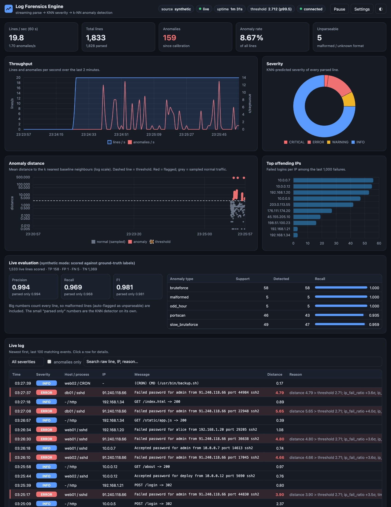
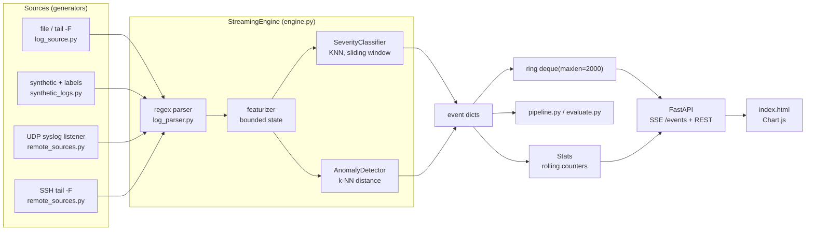
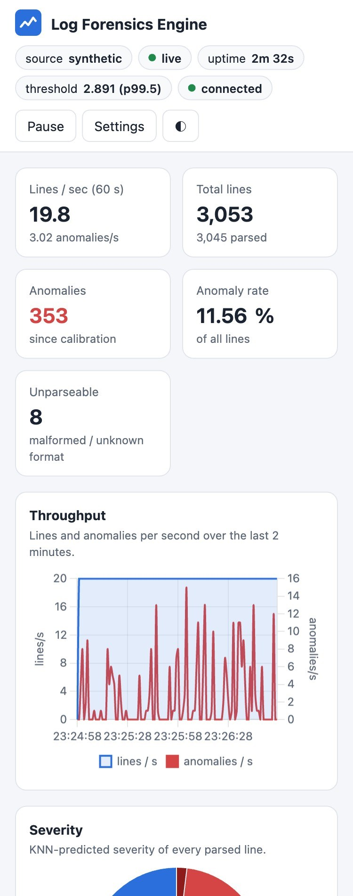
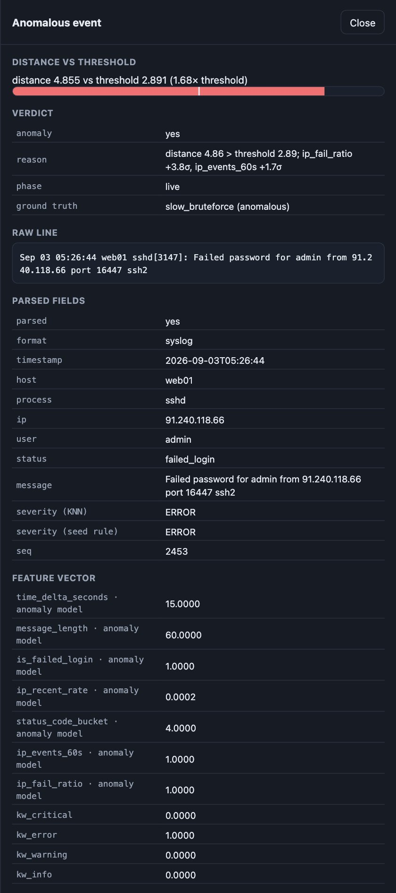
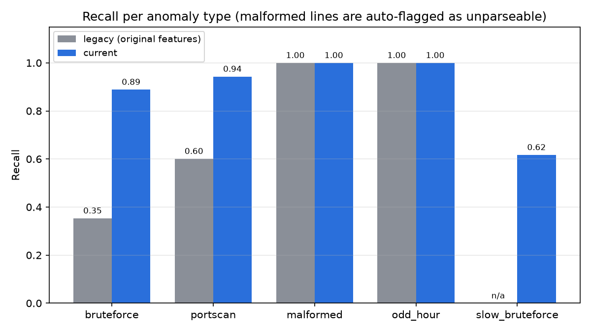
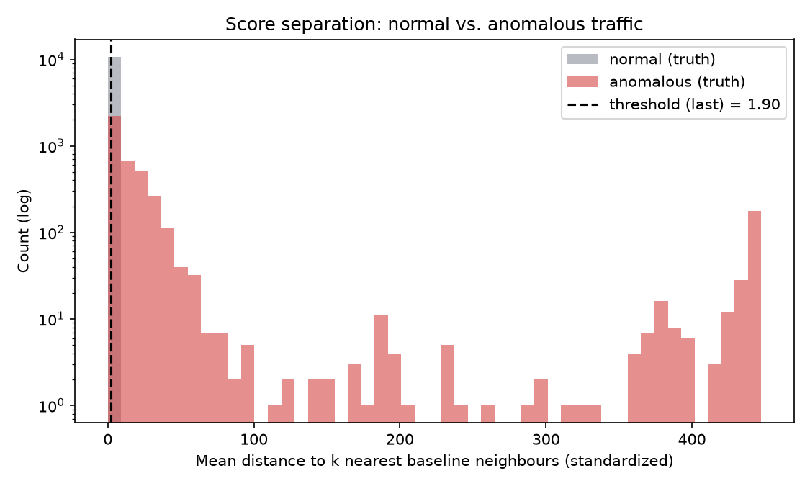
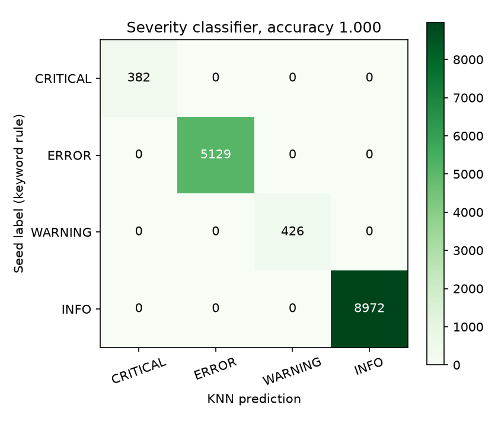
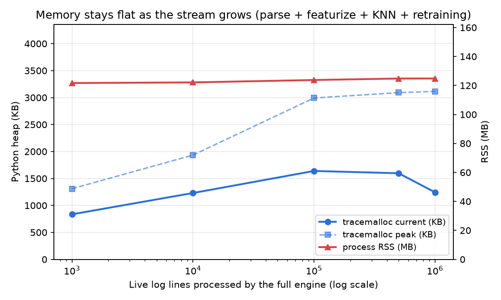

# Log Forensics Engine

A streaming log analyser. It reads server, auth and web logs **one line at a time in
constant memory**, parses them with regex, classifies severity with **KNN**, flags
anomalies by **k-nearest-neighbour distance** to a learned baseline, ingests logs from
other machines (**UDP syslog** and **SSH `tail -F`**), and shows everything on a **live
web dashboard**.

**Live demo:** https://log-forensics-engine.onrender.com (free tier: the first visit after a quiet spell takes ~1 minute to wake up)



---

## Contents

- [Quick start](#quick-start)
- [Architecture](#architecture)
- [How to run each mode](#how-to-run-each-mode)
- [The dashboard](#the-dashboard)
- [Results](#results)
- [Project layout](#project-layout)
- [What changed from the first version](#what-changed-from-the-first-version)
- [Limitations](#limitations)
- [Deployment](#deployment)
- [Future work](FUTURE_WORK.md)

## Quick start

Python 3.10+.

```bash
git clone https://github.com/dulfazl/log-forensics-engine.git
cd log-forensics-engine
python3 -m venv .venv && source .venv/bin/activate      # Windows: .venv\Scripts\activate
pip install -r requirements.txt
make test          # 103 tests
make dashboard     # open http://127.0.0.1:8000
```

No `make` (e.g. Windows)? Every target is one command; see the [Makefile](Makefile), e.g.
`python -m pytest` and `python -m dashboard.server --source synthetic`.

## Architecture



Every stage is a generator, and every piece of state is bounded:

| State | Bound |
|---|---|
| line being read | truncated at 64 KiB (`log_source.MAX_LINE_BYTES`) |
| per-IP history | LRU of 10,000 IPs × last 20 events (`featurizer`) |
| severity training window | `deque(maxlen=500)` |
| anomaly baseline | at most 5,000 rows (`AnomalyDetector.max_baseline`) |
| baseline-refresh buffer | `deque(maxlen=500)` |
| dashboard event ring / anomaly ring | 2,000 / 500 events |
| UDP datagram queue | `queue.Queue(maxsize=10000)`, overflow is dropped and counted |
| browser | table 100 rows, 500 buffered events, < 1,000 scatter points |

**How a line is scored.** The parser turns a line into a record with the same keys for
every format. The featurizer turns it into a vector: time since the previous line,
message length, failed-login flag, the IP's recent event rate, a status bucket, the IP's
event count in the last 60 s, the IP's failed-login ratio, and four keyword flags. The
first `baseline_size` parsed lines (default 300) are the calibration baseline: the
anomaly detector standardizes them and records each point's mean distance to its k=5
nearest neighbours (excluding itself). The threshold is the 99.5th percentile of those
distances. After that, a line is anomalous when its mean distance to the 5 nearest
baseline points exceeds the threshold. Lines that match no format are flagged as
`unparseable`. Severity is predicted by a KNN classifier trained on keyword-based seed
labels, refit every 100 lines on the last 500.

**Why refit instead of online KNN.** scikit-learn's KNN has no `partial_fit`: KNN is a
lazy learner whose "model" is the stored points plus a search index, and that index is
immutable once built. Adding a point means rebuilding it, and the scaler's mean and
variance would shift too. So both models keep a bounded window and refit periodically:
O(window) memory and a lag of at most one refit interval.

## How to run each mode

### Synthetic pipeline and evaluation

```bash
python pipeline.py --n 1500 --baseline 300 --anomaly-rate 0.05     # prints anomalies + metrics
python pipeline.py --legacy --quiet                                # the original configuration
python pipeline.py --mode mixed --quiet                            # syslog + access-log traffic
python evaluate.py                                                 # all configs, per-type table
python evaluate.py --n 3000 --seeds 5                              # bigger, pooled over 5 seeds
python synthetic_logs.py --n 10000 --seed 42 --mode mixed          # label counts + sha256
```

### Real log files

```bash
python pipeline.py --file /var/log/auth.log --baseline 500         # one pass over a file
python pipeline.py --tail /var/log/auth.log                        # follow it like tail -F
```

### Remote ingestion

UDP syslog, two terminals:

```bash
python demo_remote_pipeline.py --source udp          # terminal 1: listens on 127.0.0.1:5140
python demo_syslog_sender.py --count 1500            # terminal 2: the "remote machine"
```

To accept datagrams from other machines, bind explicitly: `--host 0.0.0.0`.

SSH tail of a remote file (the host key must already be in `~/.ssh/known_hosts` or in a
file passed with `--known-hosts`; `--insecure` accepts unknown keys and warns about it):

```bash
python demo_remote_pipeline.py --source ssh --ssh-host myserver --ssh-user me \
    --ssh-path /var/log/auth.log --ssh-key ~/.ssh/id_ed25519
# password auth: export LFE_SSH_PASSWORD=... (never passed on the command line)
```

### Dashboard

```bash
python -m dashboard.server --source synthetic                           # http://127.0.0.1:8000
python -m dashboard.server --source udp --port 5140                     # + demo_syslog_sender.py
python -m dashboard.server --source tail --path /var/log/auth.log
python -m dashboard.server --source ssh --ssh-host myserver --ssh-user me --ssh-path /var/log/auth.log
```

Useful flags: `--rate 50` (synthetic lines/s), `--mode syslog|access|mixed`,
`--anomaly-rate`, `--threshold 99.5`, `--baseline 300`, `--http-host/--http-port`.
The server binds to 127.0.0.1 by default. `--public-demo` restricts runtime config
changes to the synthetic source; use it whenever the server is reachable by others.

### Benchmarks, charts, checks

```bash
python memory_benchmark.py         # full engine incl. retraining, 1K -> 1M lines
python generate_charts.py          # docs/images/*.png
python -m pytest                   # 103 tests
ruff check .                       # pip install -r requirements-dev.txt
```

| make target | does |
|---|---|
| `make test` | run the test suite |
| `make demo` | pipeline run + evaluation table |
| `make dashboard` | dashboard with synthetic traffic |
| `make dashboard-udp` / `make udp-demo` | dashboard fed by UDP / send it traffic |
| `make bench` | memory benchmark |
| `make charts` | regenerate charts |
| `make lint` | ruff |

## The dashboard

Architecture: the engine runs in a background thread and appends every event to a
bounded ring buffer (`deque(maxlen=2000)`) and updates `Stats`. Each browser holds a
Server-Sent Events connection; the server keeps one cursor per client into the ring and
sends what is new every 200 ms. A client that falls more than 200 events behind skips
ahead and is told how many events it missed, so a slow client never makes the server
buffer more. A heartbeat comment goes out every 15 s, and event ids (`generation-seq`)
let a reconnecting browser resume where it left off.

| Endpoint | |
|---|---|
| `GET /` | the single-page dashboard |
| `GET /events` | SSE stream, one JSON event per message |
| `GET /api/stats` | Stats snapshot: lines/s, totals, severity counts, top IPs, threshold, baseline status, source, uptime, per-second timeline, live evaluation |
| `GET /api/anomalies?limit=100` | most recent anomalies (bounded deque) |
| `GET /api/events?limit=100` | most recent events (backfill on page load) |
| `GET /api/config`, `POST /api/config` | read / change source, `threshold_percentile`, `anomaly_rate`, ...; restarts the engine thread cleanly |
| `GET /healthz` | health check |

**What each panel means**

| Panel | Meaning |
|---|---|
| Header strip | Source, status (*calibrating n/N* while the baseline is being learned, then *live*), uptime, current threshold, connection badge (shows *disconnected* and reconnects automatically), Pause (freezes the view, the engine keeps running), Settings, theme toggle. |
| KPI cards | Lines/s over the last 60 s, total lines, anomalies, anomaly rate, unparseable lines (plus UDP drops in UDP mode). |
| Throughput | Lines/s and anomalies/s, rolling 2 minutes. |
| Severity | Doughnut of KNN-predicted CRITICAL / ERROR / WARNING / INFO. |
| Anomaly distance | Each line's k-NN distance over time (log scale) with the threshold as a dashed line; anomalies red, normal grey, sampled to stay under 1,000 points. |
| Top offending IPs | Failed logins per IP among the last 1,000 failures. |
| Live log | Last 100 events, colour-coded by severity, anomalies tinted with the reason (which standardized features stood out). Filters for severity and anomaly-only, plus search. |
| Detail drawer | Click a row: raw line, parsed fields, feature vector, distance vs threshold, ground truth (synthetic). |
| Live evaluation | Synthetic mode only: precision / recall / F1 against the ground-truth labels, with and without unparseable lines, and recall per anomaly type. |

Front-end rules: dark and light theme from CSS variables and `prefers-color-scheme`
(with a toggle), responsive down to phone width, every client-side array capped, at most
10 table rows inserted per animation frame, and **log text is only ever inserted with
`textContent`**, never as HTML, because log lines are attacker-controlled. The page is
also served with a Content-Security-Policy.

| Mobile | Detail drawer |
|---|---|
|  |  |

## Results

All numbers come from `evaluate.py` with fixed seeds, so they are reproducible.

### Overall

Configurations:

* **legacy**: the original project's setup. Syslog traffic, the four original anomaly
  types, the five original features for both models, no baseline refresh.
* **current**: syslog traffic plus everyday system messages at every severity, five
  anomaly types including the subtle slow brute force, the 7 behavioural features for the
  detector, keyword features for severity, baseline refresh with strict acceptance.
* **current-mixed**: as current, with syslog and Apache/Nginx access-log traffic mixed.

The original README reported precision 0.96 / recall 0.68 / F1 0.79. Re-running the
legacy configuration on the same data (`python evaluate.py`, 1,500 lines, seed 42) gives
**0.974 / 0.677 / 0.799**: the rebuild reproduces it.

Pooled over 5 seeds × 3,000 live lines (`python evaluate.py --n 3000 --seeds 5`):

| config | precision | recall | F1 | recall, parsed lines only | false-positive rate | severity accuracy |
|---|---|---|---|---|---|---|
| legacy | 0.980 | 0.531 | 0.689 | 0.512 | 0.4 % | 0.998 |
| current | 0.903 | 0.852 | 0.877 | 0.849 | 3.6 % | 1.000 |
| current-mixed | 0.991 | 0.801 | 0.886 | 0.794 | 0.3 % | 0.990 |

"All lines" counts malformed lines, which are flagged as unparseable without ever reaching
the model; that flatters both precision and recall. "Parsed lines only" is the KNN
detector on its own.

### Recall per anomaly type

A single F1 hides that some attacks are caught well and others barely at all:

| anomaly type | legacy | current | current-mixed |
|---|---|---|---|
| bruteforce (fast burst) | 0.35 | 0.89 | 0.79 |
| portscan (burst) | 0.60 | 0.94 | 0.82 |
| malformed | 1.00 | 1.00 | 1.00 |
| odd_hour | 1.00 | 1.00 | 1.00 |
| slow_bruteforce (1 try / 20-60 s) | n/a | 0.62 | 0.74 |



Where recall was lost, and what fixed it:

* **Brute force (0.35 in legacy).** `ip_recent_rate` divides the IP's last 20 events by
  the time they span. Attack IPs come back burst after burst, so those 20 events stretch
  back to an earlier burst, the span is long and the rate looks low *during* a new
  burst. `ip_events_60s` (events from this IP in the last minute) measures the current
  burst directly.
* **Port scan (0.60).** In the legacy setup the parser did not read `SRC=` from firewall
  lines, so scans had no IP and got no per-IP features at all. Firewall lines now carry
  `ip`, `port` and their own status bucket.
* **Slow brute force (new, 0.62-0.74).** One failure every 20-60 s looks like normal
  traffic line by line. `ip_fail_ratio` (share of failures among the IP's last 20 events)
  catches most of it; the rest are early attempts before the ratio builds up.
* **odd_hour (1.00) is a caveat, not a success.** Hour of day is not a feature. These
  lines are caught because the generator jumps the clock to 03:00, which appears as a
  long time gap. A 3 a.m. login without such a gap would be invisible.

### Threshold trade-off

The threshold percentile trades false alarms for missed attacks (`--threshold`):

| threshold | current: P / R / FPR | current-mixed: P / R / FPR |
|---|---|---|
| p99.0 | 0.777 / 0.913 / 10.3 % | 0.968 / 0.916 / 1.1 % |
| **p99.5 (default)** | **0.903 / 0.852 / 3.6 %** | **0.991 / 0.801 / 0.3 %** |
| p99.9 | 0.960 / 0.745 / 1.2 % | 1.000 / 0.396 / 0.0 % |

Most false positives in *current* are ordinary logins whose IP briefly shows an unusual
failure streak or burst: the per-IP features that buy recall also cost some precision.



### Severity classifier

The original classifier was never evaluated, and its features held no message content
even though its labels come from keywords in the message. It now sees the keyword flags,
the failed-login flag and the status bucket, and is scored against the seed labels:
accuracy **1.000** (current) and **0.990** (mixed) vs **0.964 / 0.951** for the five
original features on the same traffic.



### Memory

`memory_benchmark.py` runs the **full engine** (parsing, featurizing, anomaly scoring,
severity prediction, retraining every 100 lines, baseline refresh every 1,000, Stats)
and records `tracemalloc` and process RSS:

| live lines | tracemalloc current | tracemalloc peak | process RSS | severity refits | baseline refreshes |
|---|---|---|---|---|---|
| 1,000 | 0.8 MB | 1.3 MB | 121.7 MB | 11 | 1 |
| 10,000 | 1.2 MB | 1.9 MB | 122.1 MB | 100 | 9 |
| 100,000 | 1.6 MB | 3.0 MB | 123.8 MB | 999 | 99 |
| 500,000 | 1.6 MB | 3.1 MB | 124.8 MB | 4,982 | 498 |
| 1,000,000 | 1.2 MB | 3.1 MB | 124.8 MB | 9,965 | 996 |

Verdict printed by the benchmark: from 10K to 1M lines (100× more data) the memory held
by Python objects went from 1.23 MB to 1.24 MB, and RSS grew by 2.7 MB, of which about
119 MB is the interpreter plus numpy / scikit-learn before the first line. The small
up-and-down in "current" is the anomaly baseline growing through refreshes towards its
5,000-row cap and the per-IP table filling up; both are capped. "Peak" includes the
transient arrays of a refit. Throughput was about 4,500 lines/s on a laptop *with
tracemalloc on* (which slows Python 2-3×), using `batch_size=256`; the live dashboard
uses `batch_size=1` for per-line latency.



## Project layout

| File | Responsibility |
|---|---|
| `log_source.py` | `stream_from_file`, `tail_file` (rotation and truncation safe), `stream_from_generator` |
| `log_parser.py` | `parse_log_line`: syslog (BSD and RFC 3339, optional `<PRI>`), access logs; SSH, PAM and firewall fields; missing-year handling; `YearTracker` |
| `featurizer.py` | `new_state`, `featurize`: bounded LRU per-IP state, keyword flags, optional sin/cos hour |
| `models.py` | `SeverityClassifier` (scaled KNN, `predict_batch`, `evaluate`), `AnomalyDetector` (`score_batch`, `explain`, poisoning-resistant `refresh_baseline`) |
| `synthetic_logs.py` | deterministic labeled generator, 5 anomaly types, syslog / access / mixed modes |
| `engine.py` | `StreamingEngine` (one event per line) and `Stats` (bounded rolling counters) |
| `pipeline.py` | thin CLI over the engine |
| `evaluate.py` | precision / recall / F1 overall and per type, with and without unparseable lines, severity accuracy |
| `remote_sources.py` | `syslog_udp_listener`, `ssh_tail` |
| `demo_remote_pipeline.py`, `demo_syslog_sender.py` | two-terminal remote demo |
| `memory_benchmark.py`, `generate_charts.py` | benchmark and report charts |
| `dashboard/server.py`, `dashboard/static/index.html` | FastAPI + SSE backend, Chart.js front end |
| `tests/` | 103 tests, including an in-process SSH server for `ssh_tail` |

## What changed from the first version

Each issue found in review, and what happened to it:

| Issue | Fix |
|---|---|
| Severity KNN never evaluated; features had no message content | `SeverityClassifier.evaluate()` + confusion matrix; keyword-flag features; StandardScaler at refit |
| Recall 0.68 unexplained | per-type recall table; root causes found (stale IP rate window, firewall IP not parsed); new features; 0.85 recall pooled |
| Odd-hour anomalies invisible without the hour | documented; `use_hour=True` with sin/cos encoding for week-long baselines |
| Malformed lines inflate metrics | metrics reported with and without unparseable lines |
| Baseline and live stream restarted the clock | one continuous simulated clock (`calibrated_stream`) |
| Memory benchmark covered parse + featurize only | benchmark runs the full engine incl. KNN and retraining, with RSS and tracemalloc |
| `AutoAddPolicy` (MITM risk) | `RejectPolicy` + known_hosts; `insecure=True` is explicit and warns |
| UDP listener bound 0.0.0.0 | defaults to 127.0.0.1; bounded queue; drops counted |
| Parser ignored `<PRI>` and the year | both handled; RFC 3339 timestamps too |
| Per-IP state could grow forever | LRU capped at 10,000 IPs (tested with 1M unique IPs) |
| `kneighbors` one record at a time | `score_batch` / `predict_batch`; engine `batch_size` for offline runs |
| Unused `_fmt`, redundant `if/else` in `evaluate()` | removed |

## Limitations

1. **KNN is not online.** Both models refit on a sliding window (above). Between refits
   the models lag the stream by up to 100 lines (severity) / 1,000 lines (baseline).
2. **Hour of day is off by default.** It needs a baseline spanning at least a week; the
   default baseline covers about an hour of simulated time. `odd_hour` recall is an
   artefact of the generator's clock jump (see Results).
3. **The threshold is a trade-off**, not a fixed truth. The default p99.5 favours
   precision; see the trade-off table.
4. **Synthetic data.** Attacks were designed by us, and the features were chosen knowing
   what they look like, so the detector is partly being graded on its own exam. Real
   attacks share the signatures (bursts, repeated failures, scans), but real benign
   traffic is messier. `pipeline.py --file` works on real logs without ground truth.
5. **UDP is lossy.** Datagrams lost in the network or the kernel buffer cannot be
   counted; only drops in our own queue are. Anyone who can reach the port can inject
   lines, hence the localhost default.
6. **SSH host keys.** Unknown hosts are rejected unless `insecure=True`. Lines written
   while the connection is down are not replayed after reconnecting (`tail -n 0`).
7. **Baseline refresh can be poisoned slowly.** Only points well inside the normal range
   (75th percentile of baseline distances) are folded in. This was measured to matter:
   accepting everything below the threshold cut slow-brute-force recall from 0.60
   (refresh off) to 0.33; the strict rule gives 0.62. A patient attacker can still drift
   the baseline. `refresh_every=0` turns refresh off.
8. **The dashboard is a single process** with in-memory state and no login. The public
   demo runs with `--public-demo`, so visitors can only change synthetic-traffic settings,
   and all of them share one engine.
9. **One global baseline** for all hosts and formats (see Future work).

## Deployment

The dashboard runs on Render's free tier from [`render.yaml`](render.yaml):

```yaml
buildCommand: pip install -r requirements.txt
startCommand: python -m dashboard.server --source synthetic --public-demo --http-host 0.0.0.0 --http-port $PORT
healthCheckPath: /healthz
```

Free instances sleep after 15 minutes without traffic; the next visit wakes them, and
the engine recalibrates its baseline from scratch.

## Team

- Muhammed Dulfazal ([@dulfazl](https://github.com/dulfazl))
- Rohen Paul J ([@rohenpa05](https://github.com/rohenpa05))
- [@notadithyar](https://github.com/notadithyar)
